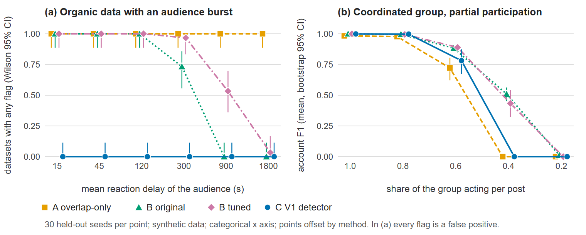

# Evaluating Temporal Coordination Detection: False-Positive Control and Robustness under Synthetic Engagement Behaviour

**Yuxi He**
Postgraduate Cyber Security student
The University of Queensland · November 2026
Detector V1 (MIT licence): https://github.com/heyuxi6666/social-coordination-detector
Evaluation code: https://github.com/heyuxi6666/social-coordination-detector/tree/research-evaluation

## Abstract

Coordinated inauthentic engagement is often detected through synchrony, yet legitimate audiences also react together. We evaluate V1, an interpretable non-machine-learning detector that flags accounts only when they repeat a personal, fixed like delay across posts. We compare it with an engagement-overlap baseline and a SynchroTrap-style time-bucket baseline tuned on separate seeds. On 1,290 held-out datasets (43 configurations × 30 seeds) of a synthetic benchmark, V1 flagged none of 390 organic-only datasets. The tuned baseline, by contrast, flagged every dataset containing an audience that reacted with a mean delay of 120 s or less. V1 was clearly worse when coordinated accounts randomised their delays (F1 ≤ 0.04 vs 1.00), at 40% participation (0.00 vs 0.43) and under 40 s of timing jitter (0.42 vs 1.00). The results characterise a trade-off within a synthetic model; they do not measure real-world accuracy.

## 1. Introduction and research questions

Synchrony is a central signal for coordinated behaviour [1–3], but ordinary audiences are synchronised too. V1 therefore tests a narrower regularity: whether the *same accounts repeat their own fixed delay* from post to post. It reports statistical anomalies, never verdicts about intent. **RQ1:** does timing-based detection outperform overlap-only detection, especially on false positives? **RQ2:** how robust is it to jitter, partial participation, wide or randomised delays and heavy users? **RQ3:** how does account rotation affect it? The contribution is an evaluation, not a new principle. It has three parts: an open fixed-offset permutation test, a reproducible benchmark with disjoint tuning and held-out seeds, and a documented account of where the design helps and where it fails.

## 2. Related work

CopyCatch [1] detects lockstep Page-Like behaviour on Facebook from the user–Page graph and like timestamps alone. SynchroTrap [2] clusters accounts whose actions on the same object, such as an IP address or a target page, fall within a matching window. It uses Jaccard similarity and connected components, and was deployed in five applications at Facebook and Instagram. Related graph methods find synchronised or dense suspicious structure [3, 4]. Pacheco et al. [5] build coordination networks from shared behavioural traces without supervision, and Giglietto et al. [6] define coordinated link sharing through a short time window. Newer spambots evade older detectors [7, 8], and supervised graph-based detection uses benchmarks such as TwiBot-22 [9].

## 3. Methods

**Table 1.** Signals used by each method (✓ = used, – = not used).

| Signal | A overlap-only | B time-bucket | C V1 |
|---|---|---|---|
| Who liked which post | ✓ | ✓ | ✓ |
| Like timestamps | – | ✓ absolute, bucketed | ✓ per-account delay between posts |
| Post author ids | – | – | ✓ same-author yardstick |
| Account-id numbering (metadata) | – | – | ✓ id-adjacency indicator |
| Like and repost counts | – | – | ✓ repost-to-like indicator, if supplied |

**A. Overlap-only** is V1's own group-forming step. It links two posts when their liker-overlap coefficient is at least 0.3 and the Bonferroni-corrected hypergeometric p ≤ 10⁻³, then flags accounts that liked at least half of a group's posts.

**B. Time-bucket co-action** is a simplified SynchroTrap-style baseline, not a reimplementation of [2]. It turns each like into an item (post, ⌊time/*w*⌋) and links accounts that share at least 3 items with item Jaccard ≥ 0.5. Connected components of at least *n*_min accounts are flagged (originally *w* = 300 s, *n*_min = 5). Unlike SynchroTrap's matching window, fixed buckets can split near-simultaneous likes.

**C. V1** forms groups as in A and scores them on six indicators: three overlap-based, one timing (the fixed-offset cohort), one account-metadata (consecutive ids) and one count-based (the repost-to-like ratio). For posts *a* and *b* and each shared liker *i*, let *d_i* = *t_i*(*b*) − *t_i*(*a*), and let *c*_obs be the size of the largest set of shared likers whose *d_i* fit in a 20 s window. Over *R* = 500 seeded re-pairings of second-post times, *p* = (1 + #{*r* : *c_r* ≥ *c*_obs}) / (*R* + 1) [10]. A cohort is *fixed-offset* if four conditions hold: *p* ≤ 0.01; *c*_obs ≥ 10; the window centre is at least 120 s, so it is not a single browsing session; and the cohort's like times on *a* are spread over at least max(60 s, 5 × the range of its *d_i*), so it is not a single burst.

A group is rated *strong* if at least 3 indicators are measurable and all of them trigger, except single-author groups that lack both timing and same-author support. It is rated *weak* if timing is measurable but finds no fixed-offset cohort, and otherwise *moderate* if at least 2 indicators trigger. Under a rule fixed before the main experiments, strong and moderate groups are flagged, and their fixed-offset cohorts are the flagged accounts. V1's code was not modified.

## 4. Experimental setup

**Synthetic world.** Each dataset has 2,000 accounts and 30 posts over 48 h. Posts receive about 40 organic likers (±30%) with exponential delays (mean 2,400 s), and 10% of accounts are heavy users with five times the selection weight. In coordinated datasets, 40 accounts like 6 posts by 3 authors. Each account reuses a personal delay (spread over 120 s) with Gaussian jitter (sd 2 s). By default the generator supplies no repost counts and gives group accounts random ids. We vary jitter, participation, rotation, cohort spread, and a *random-delay* mode that redraws every delay. The negative scenarios are organic-only data; 35 followers liking one author's 3 posts, with a mean delay from 15 s (a burst) to 1,800 s (a loyal audience); and heavy-user weights up to 50.

**Splits and tuning.** Seeds 2000–2019 were used only to tune B, over 42 cells (*w* = 60–3,600 s, *n*_min = 3–20) and 11 scenarios (7 coordinated, 4 negative). Maximising mean F1 minus mean false-positive rate selected **w = 2,400 s, n_min = 15**; its tuning score was 0.691, against 0.677 for the original setting. All results use held-out seeds 5000–5029. A and V1 were not tuned, and the protocol was fixed before tuning.

**Metrics.** We report mean per-seed account F1, where group detection requires post-set Jaccard ≥ 0.5, and false-positive rates with Wilson intervals [11]. Paired per-seed differences compare coordinated configurations on F1 and organic-only ones on the false-positive indicator; the two are never combined.

**Intervals.** The originally specified paired intervals (mean ± 1.96 SE) fell outside [−1, 1] in 4 of 129 comparisons (lowest −1.032). We therefore report seeded percentile-bootstrap intervals (10,000 resamples) [12]; the verdicts are unchanged except in one negligible comparison. All configuration-level wins and losses are exploratory, because no multiple-comparison correction was applied.

## 5. Results and discussion

**RQ1: false positives.** V1 flagged **none of 390 organic-only held-out datasets** (Wilson upper bound 0.010). On plain organic and heavy-user data (150 datasets), every method was nearly clean, and A flagged 2. On follower-audience data (240 datasets), A flagged 240, original B 142, tuned B 167, and V1 none. Both B variants flagged every audience with a mean delay of 120 s or less (Fig. 1a). Tuning shifted their false-positive region rather than removing it: tuned B flagged 0.97 of datasets at 300 s and 0.53 at 900 s. All four detectors found the plain coordinated group in all 30 datasets, but A absorbed an adjacent loyal audience (F1 0.68). V1's *strong* tier never fired on default data (0 of 30 datasets), because the repost indicator was unmeasurable and the id-adjacency indicator did not trigger. In a diagnostic scenario that plants consecutive ids and inflated repost counts, which are exactly what those indicators measure, the *strong* tier fired in 30 of 30 diagnostic datasets. The flagging rule therefore includes *moderate*.

**Table 2.** Default settings, 30 held-out seeds. The first three rows give mean account F1; the last three give the share of organic-only datasets flagged, with Wilson 95% intervals.

| Scenario | A overlap | B original | B tuned | C V1 |
|---|---|---|---|---|
| Coordinated group | 0.98 | 1.00 | 1.00 | 1.00 |
| Coordinated + loyal audience | 0.68 | 1.00 | 1.00 | 1.00 |
| Coordinated, V1 *strong* tier only | – | – | – | 0.00 |
| Organic only | 0.00 [0.00, 0.11] | 0.00 [0.00, 0.11] | 0.00 [0.00, 0.11] | 0.00 [0.00, 0.11] |
| Loyal audience (mean delay 1,800 s) | 1.00 [0.89, 1.00] | 0.00 [0.00, 0.11] | 0.03 [0.01, 0.17] | 0.00 [0.00, 0.11] |
| Notification burst (mean delay 45 s) | 1.00 [0.89, 1.00] | 1.00 [0.89, 1.00] | 1.00 [0.89, 1.00] | 0.00 [0.00, 0.11] |

**Figure 1.** (a) Share of organic-only datasets flagged, by the mean reaction delay of a 35-account audience (Wilson 95% intervals); every flag is a false positive. (b) Mean account F1 under partial participation (percentile-bootstrap 95% intervals). 30 held-out seeds per point.

**RQ2: robustness.** V1 held at 1.00 up to a 2,000 s cohort spread. At that spread the original B fell to 0.91, while tuned B (0.99) was indistinguishable from V1 (Table 3). V1 lost clearly in three conditions. With randomised delays, F1 ≤ 0.04. This follows from its design; A and tuned B still found the overlapping group. With participation at 0.4, the overlap step V1 shares with A no longer forms a group (Fig. 1b). Under jitter, V1 scored F1 0.99 at 20 s, then 0.42 at 40 s and 0.13 at 80 s, reflecting its fixed 20 s window. Heavy users reduced A's F1 to 0.85 at weight 50 but barely affected B or V1.

**Table 3.** Mean account F1 (30 held-out seeds) and the paired difference V1 − tuned B, with a percentile-bootstrap 95% interval. The standard errors of all F1 means shown are at most 0.07.

| Setting | A | B original | B tuned | C V1 | V1 − B tuned |
|---|---|---|---|---|---|
| Cohort spread 2,000 s | 0.98 | 0.91 | 0.99 | 1.00 | +0.01 [−0.00, +0.02] |
| Random delays, range 120 s | 0.98 | 1.00 | 1.00 | 0.04 | −0.96 [−1.00, −0.90] |
| Random delays, range 2,000 s | 0.98 | 0.01 | 1.00 | 0.00 | −1.00 [−1.00, −1.00] |
| Participation 0.6 | 0.72 | 0.88 | 0.89 | 0.78 | −0.11 [−0.21, −0.02] |
| Participation 0.4 | 0.00 | 0.51 | 0.43 | 0.00 | −0.43 [−0.54, −0.32] |
| Jitter sd 40 s | 0.98 | 1.00 | 1.00 | 0.42 | −0.58 [−0.71, −0.46] |
| Jitter sd 80 s | 0.98 | 1.00 | 1.00 | 0.13 | −0.87 [−0.95, −0.78] |
| Rotation 0.1 | 0.82 | 0.83 | 0.83 | 0.91 | +0.08 [+0.07, +0.09] |
| Rotation 0.4 | 0.52 | 0.41 | 0.42 | 0.30 | −0.11 [−0.22, −0.01] |
| Rotation 0.6 | 0.06 | 0.18 | 0.16 | 0.06 | −0.10 [−0.15, −0.04] |

**RQ3: rotation.** V1 led only at rotation 0.1 (0.91 vs 0.83). A possible but untested explanation is that V1 combines cohorts from individual post pairs, whereas B needs three shared items. From rotation 0.4 V1 trailed B and returned fragments of the group (0.57 per dataset, against 0 for B). Its tracer recovered 87% of coordinated posts at rotation 0.2, 33% at 0.4 and 0% at 0.8.

**Exploratory summary.** Against tuned B, V1 was better in 1, worse in 12 and not distinguishable in 17 of the 30 coordinated configurations (compared on F1). On the 13 organic-only configurations (compared on false positives) it had fewer false positives in 6, more in 0 and no clear difference in 7. Against A, the counts were 20 / 6 / 4 and 8 / 0 / 5. At default settings the median runtime per dataset was 176.5 ms for V1, 3.0 ms for tuned B and 0.7 ms for A, on one machine.

## 6. Limitations and future work

The generator and V1 share an author and a model of coordination, so V1 is tested on the behaviour it was designed for. Nothing here estimates real-world precision or recall, and a flag is a statistical anomaly, not evidence of intent or of who controls the accounts. The synthetic world lacks follower graphs, daily cycles and adaptive adversaries; jitter does not grow with the gap between posts; and factors were varied one at a time at one dataset size. Only B was tuned, on scenario families shared with the test set (though on different seeds), and bootstrap intervals from 30 seeds can under-cover slightly. Future work includes real-data validation, adaptive adversaries, false-discovery-rate control [13], and a two-stage design in which B proposes groups and V1 filters them.

## 7. Conclusion

In this synthetic model, requiring repeated per-account delays bought near-complete rejection of legitimate synchronised audiences: V1 flagged none of 390 organic-only datasets. The price was lower recall when coordinated accounts randomised their delays, acted on only part of the posts, jittered by 40 s or more, or rotated. V1 is best viewed as an interpretable, low-false-positive *filter*, not a better detector overall, and its behaviour on real platform data is untested.

## References

[1] A. Beutel, W. Xu, V. Guruswami, C. Palow, C. Faloutsos. CopyCatch: Stopping group attacks by spotting lockstep behavior in social networks. *Proc. WWW*, 2013, pp. 119–130. doi:10.1145/2488388.2488400

[2] Q. Cao, X. Yang, J. Yu, C. Palow. Uncovering large groups of active malicious accounts in online social networks. *Proc. ACM CCS*, 2014, pp. 477–488. doi:10.1145/2660267.2660269

[3] M. Jiang, P. Cui, A. Beutel, C. Faloutsos, S. Yang. CatchSync: Catching synchronized behavior in large directed graphs. *Proc. ACM KDD*, 2014, pp. 941–950. doi:10.1145/2623330.2623632

[4] B. Hooi, H. A. Song, A. Beutel, N. Shah, K. Shin, C. Faloutsos. FRAUDAR: Bounding graph fraud in the face of camouflage. *Proc. ACM KDD*, 2016, pp. 895–904. doi:10.1145/2939672.2939747

[5] D. Pacheco, P.-M. Hui, C. Torres-Lugo, B. T. Truong, A. Flammini, F. Menczer. Uncovering coordinated networks on social media: Methods and case studies. *Proc. ICWSM*, 15(1), 2021, pp. 455–466. doi:10.1609/icwsm.v15i1.18075

[6] F. Giglietto, N. Righetti, L. Rossi, G. Marino. It takes a village to manipulate the media: Coordinated link sharing behavior during 2018 and 2019 Italian elections. *Information, Communication & Society*, 23(6), 2020, pp. 867–891. doi:10.1080/1369118X.2020.1739732

[7] S. Cresci, R. Di Pietro, M. Petrocchi, A. Spognardi, M. Tesconi. The paradigm-shift of social spambots: Evidence, theories, and tools for the arms race. *Proc. WWW Companion*, 2017, pp. 963–972. doi:10.1145/3041021.3055135

[8] E. Ferrara, O. Varol, C. Davis, F. Menczer, A. Flammini. The rise of social bots. *Communications of the ACM*, 59(7), 2016, pp. 96–104. doi:10.1145/2818717

[9] S. Feng, Z. Tan, H. Wan, et al. TwiBot-22: Towards graph-based Twitter bot detection. arXiv:2206.04564, 2022.

[10] B. Phipson, G. K. Smyth. Permutation p-values should never be zero: Calculating exact p-values when permutations are randomly drawn. *Statistical Applications in Genetics and Molecular Biology*, 9(1), 2010. doi:10.2202/1544-6115.1585

[11] E. B. Wilson. Probable inference, the law of succession, and statistical inference. *Journal of the American Statistical Association*, 22(158), 1927, pp. 209–212. doi:10.1080/01621459.1927.10502953

[12] B. Efron. Bootstrap methods: Another look at the jackknife. *The Annals of Statistics*, 7(1), 1979, pp. 1–26. doi:10.1214/aos/1176344552

[13] Y. Benjamini, Y. Hochberg. Controlling the false discovery rate: A practical and powerful approach to multiple testing. *Journal of the Royal Statistical Society: Series B*, 57(1), 1995, pp. 289–300. doi:10.1111/j.2517-6161.1995.tb02031.x
