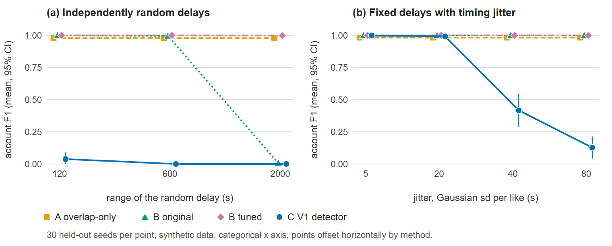

# Evaluating Temporal Coordination Detection: False-Positive Control and Robustness under Synthetic Engagement Behaviour

*[Author name]* · Master of Cyber Security (in progress), The University of Queensland · November 2026
Code: `social-coordination-detector` (MIT licence); evaluation on branch `research-evaluation`.

## Abstract

Coordinated inauthentic engagement is commonly detected by finding accounts that act together in time. Legitimate audiences, such as followers reacting to a notification, also act together. We evaluate V1, an interpretable non-machine-learning detector that flags a group only when the same accounts repeat a personal, fixed delay across posts, checked with a seeded permutation test. V1 is compared with an engagement-overlap baseline and a SynchroTrap-style time-bucket baseline, the latter tuned on separate seeds. On a synthetic benchmark of 1,290 held-out datasets (43 configurations × 30 seeds), V1 flagged none of 390 organic-only datasets. The tuned time-bucket baseline flagged every dataset that contained an audience reacting with a mean delay of 120 s or less. V1 was clearly worse in three conditions: when coordinated accounts randomised their delays (F1 ≤ 0.04 vs 1.00), at 40% participation (0.00 vs 0.43), and under 40 s of timing jitter (0.42 vs 1.00). These results describe a false-positive/recall trade-off within one synthetic world model, not real-world accuracy.

## 1. Introduction and research questions

Synchrony, meaning accounts acting on the same objects at nearly the same time, is a central signal for coordinated behaviour [1–3]. It also describes ordinary audiences, and false positives penalise legitimate communities. V1 therefore tests a narrower regularity: whether the *same accounts repeat their own fixed delay* from post to post. Scripted accounts can produce this pattern; independent human reactions are not expected to. V1 reports statistical anomalies with their baselines, never verdicts.

We ask: **RQ1** – does timing-based detection outperform engagement-overlap-only detection, especially on false positives? **RQ2** – how robust is it to jitter, partial participation, wide or randomised delays and heavy-user activity? **RQ3** – how does account rotation affect detection and cohort tracing?

**Contribution.** Lockstep and synchronised-action detection are established [1–3], so the contribution is an evaluation, not a new principle: (i) an open, dependency-free fixed-offset permutation test with explicit false-positive controls; (ii) a reproducible synthetic benchmark with disjoint tuning and held-out seeds; and (iii) an honest map of where the design helps and where it fails.

## 2. Related work

CopyCatch [1] found Facebook users who liked the same pages within the same time windows ("lockstep" behaviour). SynchroTrap [2] clustered accounts with loosely synchronised actions at the scale of large social networks. CatchSync [3] detects synchronised behaviour in directed graphs, and FRAUDAR [4] finds dense subgraphs despite camouflage. Pacheco et al. [5] build coordination networks from shared behavioural traces, and Giglietto et al. [6] define coordinated link sharing as the same URL shared within a short window. Cresci et al. [7] showed that newer spambots evade older detectors; Ferrara et al. [8] survey social bots, and supervised graph-based detection uses benchmarks such as TwiBot-22 [9]. We instead study one interpretable test and its false positives on legitimate synchronised audiences.

## 3. Methods

Each method receives, for every post, its likers and their like times.

**A. Overlap-only** is V1's own group-forming step without timing. Post pairs are linked when the liker-overlap coefficient is at least 0.3 and the Bonferroni-corrected hypergeometric p ≤ 10⁻³, and accounts that liked at least half of a group's posts are flagged.

**B. Time-bucket co-action** is SynchroTrap-inspired but does not reimplement [2]. Each like becomes an item (post, ⌊time/w⌋). Accounts sharing at least 3 items with item Jaccard ≥ 0.5 are linked, and components of at least *m* accounts are flagged. The original setting is w = 300 s, m = 5; the tuned setting is described in Section 4.

**C. V1.** Groups are formed as in A. For each post pair, V1 finds the largest *cohort* of shared likers whose delay differences between the two posts fit in a 20 s window. It tests that cohort against 500 seeded permutations of second-post times, with p = (b+1)/(m+1) [10]. A cohort is *fixed-offset* when p ≤ 0.01, it has at least 10 accounts, its typical delay difference is at least 120 s (which excludes single browsing sessions), and its like times span at least max(60 s, 5 × its range of delay differences), which excludes single bursts. Groups rated *strong* or *moderate* are flagged, a rule fixed before the main experiments, and the flagged accounts are the fixed-offset cohort. V1's code was not modified.

## 4. Experimental setup

**Synthetic world.** Each dataset has 2,000 accounts and 30 posts over 48 hours. Each post has about 40 organic likers (±30%) with exponential delays (mean 2,400 s); ten per cent of accounts are heavy users with five times the selection weight. In coordinated datasets, a group of 40 accounts likes 6 posts by 3 authors, and each member reuses a personal delay (spread over 120 s) with Gaussian jitter (sd 2 s). The varied factors are jitter, participation (the per-post probability that a member acts), rotation (the per-post probability that a member is replaced), cohort spread, and a *random-delay* mode that redraws every delay. The negatives are organic-only data, 35 followers liking one author's 3 posts with a mean delay from 15 s (a burst) to 1,800 s (a loyal audience), and heavy-user weights up to 50.

**Splits.** Tuning seeds 2000–2019 were used only to tune B, over 42 cells (w = 60–3,600 s, m = 3–20) and 11 scenarios (7 coordinated, 4 negative). The objective, mean F1 minus mean false-positive rate, selected **w = 2,400 s, m = 15** (score 0.691, against 0.677 for the original setting). All reported results use held-out seeds 5000–5029. Neither A nor V1 was tuned, and the protocol was fixed before tuning.

**Metrics.** We report account F1 (mean per seed ± SE) and group detection, where a flagged group must match the true posts with Jaccard ≥ 0.5. The false-positive rate is the share of organic-only datasets with any flag, with Wilson 95% intervals [11]. Paired per-seed differences carry 95% intervals, and a win or loss is claimed only when the interval excludes zero.

## 5. Results and discussion

**RQ1: false positives.** V1 flagged **none of 390 organic-only held-out datasets** (Wilson upper bound 0.010). On plain organic and heavy-user data (150 datasets) every method was nearly clean, and A flagged 2. On follower-audience data (240 datasets), A flagged 240, original B 142, tuned B 167, and V1 none. Both B variants flag every audience reacting with a mean delay of 120 s or less (Fig. 1a). Tuning moved B's false-positive region towards slower audiences without removing it: tuned B flagged 0.97 of datasets at 300 s and 0.53 at 900 s. On easy coordinated data, A, both B variants and V1 detected the group in all 30 datasets. When a loyal audience was added next to the group, A absorbed it (F1 0.68).

**Table 1.** Default settings, 30 held-out seeds. The first three rows give account F1; the last three give the share of organic-only datasets flagged, with Wilson 95% intervals.

| Scenario | A overlap | B original | B tuned | C V1 |
|---|---|---|---|---|
| Coordinated group | 0.98 | 1.00 | 1.00 | 1.00 |
| Coordinated + loyal audience | 0.68 | 1.00 | 1.00 | 1.00 |
| Coordinated, V1 *strong* tier only | – | – | – | 0.00 |
| Organic only | 0.00 [0.00, 0.11] | 0.00 [0.00, 0.11] | 0.00 [0.00, 0.11] | 0.00 [0.00, 0.11] |
| Loyal audience (mean delay 1,800 s) | 1.00 [0.89, 1.00] | 0.00 [0.00, 0.11] | 0.03 [0.01, 0.17] | 0.00 [0.00, 0.11] |
| Notification burst (mean delay 45 s) | 1.00 [0.89, 1.00] | 1.00 [0.89, 1.00] | 1.00 [0.89, 1.00] | 0.00 [0.00, 0.11] |

V1's *strong* tier fired only when two side signals were also present (consecutive account ids and inflated reposts), in 30 of 30 such datasets. The tier measures agreement between indicators, not timing strength, which is why the flagging rule includes *moderate*.

**Figure 1.** (a) Share of organic-only datasets flagged, by the mean reaction delay of a 35-account audience; every flag is a false positive. (b) Account F1 under partial participation. Means with 95% intervals; 30 held-out seeds per point.

**RQ2: robustness.** V1 held at 1.00 up to a 2,000 s cohort spread. At that spread the original B fell to 0.91, and tuned B (0.99) was indistinguishable from V1. V1 lost clearly in three conditions (Table 2). With *randomised delays* (Fig. 2a) its F1 was at most 0.04. This is inherent to the design: the group still overlaps, so A and tuned B found it. Under *partial participation* (Fig. 1b) it scored 0.78 against 0.89 at 0.6, and 0.00 against 0.43 at 0.4, where the overlap step V1 shares with A no longer forms a group. Under *jitter* (Fig. 2b) it scored 0.99 at 20 s, 0.42 at 40 s and 0.13 at 80 s, against 1.00 for B, a direct consequence of its fixed 20 s window. Heavy users lowered A's F1 to 0.85 at weight 50, but barely affected B or V1.

**Table 2.** Account F1 (mean ± SE, 30 held-out seeds) and the paired difference V1 − tuned B (95% CI).

| Setting | A | B original | B tuned | C V1 | V1 − B tuned |
|---|---|---|---|---|---|
| Cohort spread 2,000 s | 0.98 ± 0.00 | 0.91 ± 0.01 | 0.99 ± 0.01 | 1.00 ± 0.00 | +0.01 [−0.01, +0.02] |
| Random delays, range 600 s | 0.98 ± 0.00 | 1.00 ± 0.00 | 1.00 ± 0.00 | 0.00 ± 0.00 | −1.00 [−1.00, −1.00] |
| Participation 0.6 | 0.72 ± 0.05 | 0.88 ± 0.01 | 0.89 ± 0.01 | 0.78 ± 0.05 | −0.11 [−0.20, −0.01] |
| Participation 0.4 | 0.00 ± 0.00 | 0.51 ± 0.03 | 0.43 ± 0.06 | 0.00 ± 0.00 | −0.43 [−0.55, −0.32] |
| Jitter sd 40 s | 0.98 ± 0.00 | 1.00 ± 0.00 | 1.00 ± 0.00 | 0.42 ± 0.07 | −0.58 [−0.71, −0.46] |
| Rotation 0.1 | 0.82 ± 0.01 | 0.83 ± 0.01 | 0.83 ± 0.01 | 0.91 ± 0.01 | +0.08 [+0.07, +0.09] |
| Rotation 0.4 | 0.52 ± 0.02 | 0.41 ± 0.01 | 0.42 ± 0.01 | 0.30 ± 0.05 | −0.11 [−0.23, −0.00] |
| Rotation 0.6 | 0.06 ± 0.02 | 0.18 ± 0.01 | 0.16 ± 0.02 | 0.06 ± 0.02 | −0.10 [−0.15, −0.04] |

**Figure 2.** Account F1 when coordinated accounts (a) redraw their delay for every post and (b) keep a fixed delay with Gaussian jitter. Means with 95% intervals; 30 held-out seeds per point.

**RQ3: rotation.** V1 led at rotation 0.1 (0.91 vs 0.83). One explanation, consistent with the method definitions but not tested directly: V1 combines cohorts from individual post pairs, so it can flag a rotated-in account seen on only two posts, which B, needing three shared items, cannot. From rotation 0.4 onward V1 trailed B and returned group fragments (0.57 per dataset, against 0 for B). V1's tracer follows accounts that liked every seed post. It recovered 87% of coordinated posts at rotation 0.2, 33% at 0.4 and 0% at 0.8, so membership-based cohorts do not survive turnover.

**Overall.** Across the 43 configurations, V1 beat tuned B in 7 (six audience settings and light rotation), lost in 12 and tied in 24. Against A it won 28, lost 6 and tied 9. At default settings the median runtime per dataset was 176.5 ms for V1, 3.0 ms for tuned B and 0.7 ms for A on one machine. V1's per-configuration medians ranged from 22 to 354 ms. These counts are descriptive: there is no multiple-comparison correction, and some differences are about 0.01. The supported claim is narrow. In this model, requiring repeated per-account delays buys near-complete rejection of legitimate synchronised audiences, at a large recall cost whenever coordinated accounts do not repeat their delays.

## 6. Limitations and future work

The generator and V1 share an author and a model of coordination, so V1 is tested on the behaviour it was designed for. Nothing here estimates real-world precision or recall, and a flag is a statistical anomaly, not evidence of malicious intent or of who controls the accounts. The synthetic world has no follower graphs, daily cycles or adaptive adversaries; jitter does not grow with the time between posts, and each experiment varies one factor at a single dataset size. Only B was tuned, on scenario families shared with the test set (though on different seeds), and an objective with a hard false-positive cap would select other settings. The paired intervals use a normal approximation, and there is no multiple-comparison correction. Future work comprises validation on real data against independently corroborated coordination, gap-dependent jitter and adaptive adversaries, false-discovery-rate control [12], and a two-stage design in which B proposes groups and V1 filters them.

## 7. Conclusion

Under disjoint tuning and held-out seeds, a fixed-offset permutation test rejected legitimate synchronised audiences that overlap and time-bucket baselines flagged, and it flagged none of 390 organic-only datasets. The same design missed coordinated accounts that randomise their delays, and was less robust than a tuned time-bucket baseline to partial participation, large jitter and rotation. V1 is best viewed as an interpretable low-false-positive *filter*, not a better detector overall. Its behaviour on real platform data is untested.

## References

[1] A. Beutel, W. Xu, V. Guruswami, C. Palow, C. Faloutsos. CopyCatch: Stopping group attacks by spotting lockstep behavior in social networks. *Proc. WWW*, 2013, pp. 119–130. doi:10.1145/2488388.2488400

[2] Q. Cao, X. Yang, J. Yu, C. Palow. Uncovering large groups of active malicious accounts in online social networks. *Proc. ACM CCS*, 2014, pp. 477–488. doi:10.1145/2660267.2660269

[3] M. Jiang, P. Cui, A. Beutel, C. Faloutsos, S. Yang. CatchSync: Catching synchronized behavior in large directed graphs. *Proc. ACM KDD*, 2014, pp. 941–950. doi:10.1145/2623330.2623632

[4] B. Hooi, H. A. Song, A. Beutel, N. Shah, K. Shin, C. Faloutsos. FRAUDAR: Bounding graph fraud in the face of camouflage. *Proc. ACM KDD*, 2016, pp. 895–904. doi:10.1145/2939672.2939747

[5] D. Pacheco, P.-M. Hui, C. Torres-Lugo, B. T. Truong, A. Flammini, F. Menczer. Uncovering coordinated networks on social media: Methods and case studies. *Proc. ICWSM*, 15(1), 2021, pp. 455–466. doi:10.1609/icwsm.v15i1.18075

[6] F. Giglietto, N. Righetti, L. Rossi, G. Marino. It takes a village to manipulate the media: Coordinated link sharing behavior during 2018 and 2019 Italian elections. *Information, Communication & Society*, 23(6), 2020, pp. 867–891. doi:10.1080/1369118X.2020.1739732

[7] S. Cresci, R. Di Pietro, M. Petrocchi, A. Spognardi, M. Tesconi. The paradigm-shift of social spambots: Evidence, theories, and tools for the arms race. *Proc. WWW Companion*, 2017, pp. 963–972. doi:10.1145/3041021.3055135

[8] E. Ferrara, O. Varol, C. Davis, F. Menczer, A. Flammini. The rise of social bots. *Communications of the ACM*, 59(7), 2016, pp. 96–104. doi:10.1145/2818717

[9] S. Feng, Z. Tan, H. Wan, et al. TwiBot-22: Towards graph-based Twitter bot detection. arXiv:2206.04564, 2022.

[10] B. Phipson, G. K. Smyth. Permutation p-values should never be zero: Calculating exact p-values when permutations are randomly drawn. *Statistical Applications in Genetics and Molecular Biology*, 9(1), 2010. doi:10.2202/1544-6115.1585

[11] E. B. Wilson. Probable inference, the law of succession, and statistical inference. *Journal of the American Statistical Association*, 22(158), 1927, pp. 209–212. doi:10.1080/01621459.1927.10502953

[12] Y. Benjamini, Y. Hochberg. Controlling the false discovery rate: A practical and powerful approach to multiple testing. *Journal of the Royal Statistical Society: Series B*, 57(1), 1995, pp. 289–300. doi:10.1111/j.2517-6161.1995.tb02031.x
